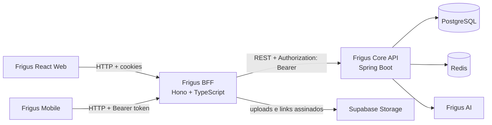

# Frigus BFF

> Backend for Frontend do Frigus: uma API HTTP em TypeScript que oferece contratos para as interfaces web e mobile e integra esses canais à Core API.

## Papel na arquitetura

O navegador e o aplicativo mobile chamam o BFF. Ele mantém rotas separadas por canal, valida entradas, adapta algumas respostas e erros, controla a sessão web em cookies `HttpOnly` e encaminha operações de domínio para a Core API. Também prepara uploads e URLs temporárias para imagens de perfil e anexos de conversa no Supabase Storage.

A Core API continua sendo responsável pelas regras de negócio, autorização, persistência e integrações do domínio. O BFF não acessa PostgreSQL nem Redis diretamente.



### Responsabilidades

| Componente | Responsabilidade |
| --- | --- |
| BFF | Contratos HTTP por canal, validação de payloads, sessão do navegador, adaptação e encaminhamento de chamadas, e normalização de erros. |
| Core API | Autenticação e autorização de domínio, regras de negócio, persistência e integrações do produto. |
| Supabase Storage | Armazenamento de fotos de perfil e anexos privados de conversa. O BFF prepara uploads assinados e URLs assinadas para leitura. |

## Canais e contratos

As rotas estão montadas em `src/channels/`. Os contratos completos do canal mobile e os mapeamentos de tela ficam nos documentos em [`docs/`](docs/).

| Prefixo | Capacidades principais |
| --- | --- |
| `/health` | Health check do processo. Não verifica Core API nem Storage. |
| `/web/auth` | Login por senha ou Google, cadastro, renovação e encerramento de sessão, recuperação de senha. |
| `/web/profile` | Consulta e edição do perfil, senha, onboarding e upload da foto. |
| `/web/user` | Consulta e operações administrativas de usuários. |
| `/web/core` | Grupos, estoque, listas de compras, descarte, chat, anúncios e funcionalidades comerciais. |
| `/web/plans` | Catálogo de planos e operações de assinatura. |
| `/web/transactions` | Checkout e consulta/cancelamento de transações. |
| `/web/domestic` | Desativado; as telas usam operações persistidas em `/web/core`. |
| `/mobile/user` | Login, cadastro e consulta do perfil mobile. |
| `/mobile/home`, `/mobile/inventory`, `/mobile/shopping-list` | Painel, estoque, movimentações, compras e leitura de comprovantes. |
| `/mobile/recipes`, `/mobile/notifications`, `/mobile/advertisements` | Receitas, notificações e anúncios. |
| `/mobile/commercial`, `/mobile/core` | Recursos comerciais e proxy de operações da Core API. |
| `/mobile/firebase` | Criação de sessão Firebase vinculada à identidade autenticada. |

A tabela é um mapa de áreas, não uma especificação completa de métodos e payloads. Consulte [`docs/mobile-api-contracts.md`](docs/mobile-api-contracts.md), [`docs/frontend-screen-contract.md`](docs/frontend-screen-contract.md), [`docs/mobile-screen-contract.md`](docs/mobile-screen-contract.md) e [`docs/core-api-todo.md`](docs/core-api-todo.md). Os arquivos de rota e schemas em `src/channels/` e `src/schemas/` são a fonte de verdade dos contratos implementados.

### Sessão e autenticação

- **Web:** login grava access token, refresh token e preferência `rememberMe` em cookies `HttpOnly`. O access cookie dura 15 minutos; `rememberMe` torna os cookies de refresh persistentes por 30 dias. Sem essa opção, o refresh cookie é de sessão.
- **Web entre sites:** quando web e BFF estão em sites diferentes, os cookies usam `SameSite=None; Secure`. Em produção, `Secure` é habilitado. Em desenvolvimento local no mesmo site, o padrão é `SameSite=Lax`.
- **Mobile:** login e cadastro usam rotas próprias; chamadas autenticadas apresentam `Authorization: Bearer`. O BFF encaminha à Core API somente o token Bearer, sem encaminhar os cookies web.
- **Google:** `POST /web/auth/google` recebe o ID token, encaminha à Core API e estabelece os cookies da sessão web. O mesmo OAuth Client ID deve estar configurado no frontend e na Core API; o BFF não precisa armazená-lo.

As mutações do canal web exigem um cabeçalho `Origin` presente e incluído em `WEB_ORIGINS`. CORS também usa essa allowlist e permite credenciais. Configure na Core API a lista correspondente em `CORS_ALLOWED_ORIGINS`.

As rotas públicas de autenticação aplicam limite local de 10 requisições por janela de 15 minutos por endereço, rota e método. Por padrão, o endereço vem da conexão. Configure `TRUST_PROXY=true` somente atrás de um proxy confiável que sobrescreve `X-Forwarded-For`. O contador fica em memória por processo; réplicas não compartilham o limite.

## Tecnologias e organização

- Node.js, TypeScript e [Hono](https://hono.dev/) para HTTP.
- Zod para validar configuração, parâmetros e corpos de requisição.
- Axios para chamadas à Core API, com timeout configurável.
- Supabase Storage para os fluxos de upload e leitura de arquivos privados.
- Firebase Admin para a sessão Firebase iniciada pelo canal mobile.

```text
src/
├── app.ts                 # Middleware global, health check e montagem dos canais
├── channels/
│   ├── web/               # Rotas e contratos para o navegador
│   └── mobile/            # Rotas e contratos para o app mobile
├── config/                # Leitura e validação de variáveis de ambiente
├── exceptions/            # Erros e respostas HTTP da aplicação
├── middlewares/           # Sessão, rate limit, contexto e handler de erros
├── schemas/               # Schemas Zod compartilhados
├── services/              # Integração com Core API e serviços externos
├── types/                 # Tipos de requests, responses e domínio
└── utils/                 # Cliente HTTP e utilitários
```

O middleware global adiciona cabeçalhos de segurança, limita o corpo das requisições a 1 MiB, configura CORS e disponibiliza `X-Correlation-ID`. Erros de validação e erros da aplicação são convertidos a respostas JSON consistentes.

## Configuração local

### Serviços locais

Antes de iniciar o BFF, execute a Core API localmente e deixe-a acessível em `http://localhost:8080` (ou ajuste `API_BASE_URL`). A Core API depende de PostgreSQL e Redis iniciados localmente; consulte o README dela para configurar essas dependências.

### Somente o BFF

Pré-requisitos: Node.js 22 e Core API iniciada localmente.

```bash
cd bff
cp .env.example .env
npm ci
npm run dev
```

O servidor usa `http://localhost:3000` por padrão. O exemplo local da Core API é `http://localhost:8080`; ajuste `API_BASE_URL` quando necessário. A origem do frontend local já está contemplada no default de `WEB_ORIGINS`.

### Variáveis de ambiente

| Variável | Obrigatória | Uso e padrão |
| --- | --- | --- |
| `PORT` | Não | Porta HTTP; padrão `3000`. |
| `NODE_ENV` | Não | `development`, `production` ou `test`; padrão `development`. |
| `API_BASE_URL` | Não | URL base da Core API; padrão `http://localhost:8080`. |
| `API_TIMEOUT_MS` | Não | Timeout das chamadas à Core API em ms; padrão `10000`. |
| `WEB_ORIGINS` | Não | Origens web HTTP(S) exatas, separadas por vírgula; padrão `localhost:5173` e `127.0.0.1:5173`. Não aceita curingas nem caminhos. |
| `TRUST_PROXY` | Não | `false` por padrão; quando `true`, usa o primeiro IP válido de `X-Forwarded-For` no rate limit de autenticação. |
| `SUPABASE_URL` | Para uploads | URL do projeto Supabase. |
| `SUPABASE_SECRET_KEY` | Para uploads | Chave secreta usada somente no servidor. Nunca exponha ao navegador. |
| `SUPABASE_STORAGE_BUCKET` | Não | Bucket de foto de perfil; padrão `profile-picture`. |
| `SUPABASE_CHAT_BUCKET` | Não | Bucket de anexos; padrão `chat-attachments`. |
| `FIREBASE_PROJECT_ID` | Para sessão Firebase | ID do projeto Firebase. A credencial Admin pode vir de `FIREBASE_SERVICE_ACCOUNT_JSON` ou Application Default Credentials. |

As variáveis de ambiente são validadas no startup em `src/config/env.ts`; consulte também [`.env.example`](.env.example). Não versione arquivos `.env` ou credenciais reais.

## Scripts e execução

| Comando | Finalidade |
| --- | --- |
| `npm run dev` | Executa com reload usando `tsx watch`. |
| `npm run typecheck` | Verifica tipos TypeScript sem emitir arquivos. |
| `npm test` | Executa verificações utilitárias e testes automatizados. |
| `npm run build` | Compila TypeScript para `dist/`. |
| `npm start` | Inicia a aplicação compilada em `dist/`. |

`GET /health` confirma que o processo HTTP está respondendo. A disponibilidade da Core API e do Supabase deve ser verificada separadamente.

## Execução local integrada

Para desenvolver o fluxo completo, mantenha PostgreSQL e Redis ativos localmente, inicie a Core API em `http://localhost:8080`, depois inicie o BFF em `http://localhost:3000` e o React Web em `http://localhost:5173`. O BFF aceita essas origens por padrão e encaminha chamadas à Core API local.

`GET /health` confirma que o processo BFF está respondendo; verifique separadamente a Core API e os serviços de armazenamento configurados.

## Repositórios relacionados

- [Core API](../core-api/): API de domínio Java/Spring Boot, PostgreSQL, Redis e integrações do produto.
- [React Web](../web/): interface React/TypeScript; chama o BFF e usa cookies de sessão.

Consulte também [`../web/README.md`](../web/README.md) para a arquitetura do frontend e o fluxo de plano/checkout. A documentação técnica da Core API descreve seus domínios, dependências e execução; confirme os paths e contratos com o OpenAPI e os controllers da branch que estiver usando.

## Licença

Consulte [`LICENSE`](LICENSE).
